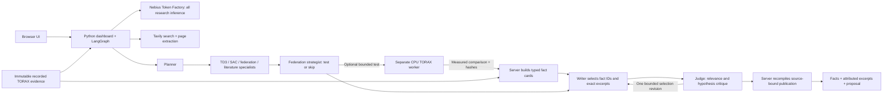

# Fusion Research Agent

A research agent that reads real TORAX/TD3/SAC experiment evidence, searches and
extracts literature with Tavily, and uses seven LangGraph model contexts through
Nebius Token Factory to produce a sourced critique and a next-experiment proposal.
An optional bounded shadow trial tests a single change with fresh controllers.

## Watch the project explanation — in order

**Please watch the three videos in this order: 1 → 2 → 3.**

1. **Start here:** [Project explanation — Part 1](https://www.loom.com/share/cf02db42bac04ab5bc3c84b9c7675de1)
2. **Watch second:** [Project explanation — Part 2](https://www.loom.com/share/c91b19a804b3486a99e80ef7a841358c)
3. **Watch last:** [Project explanation — Part 3](https://www.loom.com/share/fff3a216ff464a59899e1853b2ff4c76)

This is an executable research prototype. The default report now uses typed
selection: the model chooses evidence IDs and excerpts, while server code writes
the factual statements, exact citations and validated next-run proposal. Optional
model explanations remain explicitly untested hypotheses. A model judge cannot
promote them into measured findings. One complete live run of this reporting
path has passed independent audit: all seven Nebius-backed roles, Tavily search
and extraction, a real 56-episode TORAX shadow, and the final sourced report.
This verifies that bounded workflow, not universal model reliability or a
federation benefit. Read [the reporting boundary](docs/reporting_integrity.md)
and [the retained attempt history](docs/verification_log.md).
A separate live negative-result check also passed independent audit: it reported
the unfavorable learning-rate change across all four controls, kept the baseline
and rejected an unsupported improvement hypothesis. It read saved evidence and
launched no new physics.
A [public verification record](examples/verification/reporting_check.json)
contains the audited run's eight facts, two local source snapshots, 35 check
results and one 25-word attributed excerpt. It is an explicit projection, not
the full trace or a bulk copy of web sources.
The [negative verification record](examples/verification/negative_reporting_check.json)
preserves the second scoped audit; its report is separate from the positive
clipping reproduction.
The demo includes three saved CPU TORAX datasets; opening the app does not
run physics. A single-user container deployment runs on a Nebius VM, with model
inference on Token Factory and retrieval through Tavily. Optional live TORAX
generation is explicitly **Experimental / Beta — may fail**, requires opt-in, and
uses CPU with in-process aggregation. No production reactor control or GPU
training is claimed.
Read [what the agents, shadow test and worker each do](docs/shadow_workflow.md).

## Run the app and inspect real evidence

Install Python 3.12 and [uv](https://docs.astral.sh/uv/getting-started/installation/).
From the repository root:

```sh
cd flower-app
uv sync --locked --extra research --extra dev
uv run --no-sync python dashboard.py
```

Open http://127.0.0.1:8787/#research. The TD3 critic-coordinate development dataset
is selected as the focused first audit; the two SAC datasets are also available.
Use offline inspection without credentials. These are real recorded
measurements; offline inspection does not use an LLM or search the web.
Read [the evidence provenance](examples/evidence/README.md) and the
[three-trial audit, including reporting failures](docs/three_trial_audit.md).

## Run the seven-agent research workflow

Copy `flower-app/research.env.example` to `flower-app/.env.research` and configure
`NEBIUS_API_KEY` and `TAVILY_API_KEY` locally. Never commit that file. Choose a
tool-capable model available to your Token Factory account. Stop the local
dashboard before restarting it with the environment file:

```sh
cd flower-app
uv run --env-file .env.research --no-sync python scripts/verify_research_providers.py
uv run --env-file .env.research --no-sync python dashboard.py
```

Ask: **Does the saved evidence justify claiming federation helps a cold-start
reactor, and which small experiment should we run next?** Select the real example
evidence and live mode. The trace records plans, search/extraction calls, findings,
citations and judgment. The writer selects immutable experimental fact cards and
exact attributed literature excerpts. The judge critiques relevance and untested
hypotheses, can request one bounded selection revision using captured evidence,
or return insufficient evidence. The server rebuilds the final answer from the
selected sources; neither writer prose nor judge approval can change its facts.
Current and historical trials remain explicitly labelled. Unknown references in
optional hypotheses are quarantined and traced, rather than repaired or published.
For a current bounded shadow or one verified saved single-seed trial, the server
includes the complete recorded comparison
(up to 12 cards: status, changed setting, accounting, all four cost and competence
comparisons, plus clipping when recorded). Optional model choices cannot displace
required measurements or its recorded recommendation. Multiple saved datasets
retain bounded selection; they are never silently pooled. Saved measurements
remain labelled historical. Malformed optional annotations are excluded and traced. A required literature
excerpt must come from an extracted, hash-bound snapshot at a recognized paper
URL. Secondary summaries cannot fill that slot, even if a model judge approves.
This URL/path check does not certify authorship, peer review or scientific quality;
missing eligible literature leaves the report insufficient.
The server validates exact excerpts before offering their IDs and rebuilds the
selection against the original question and source snapshots at publication.

Exact quotations do not establish that a paper applies to this controller.
Inspect the selected source context and the separately labelled hypotheses.
`scripts/verify_research_judge.py` retains the earlier bounded semantic-judge
probe for comparison; it is not the new publication gate or a full live-run test.

## Optional live TORAX generation — Experimental / Beta

The app and RL worker use separate virtual environments to isolate web-agent
dependencies from the TORAX numerical runtime. The research UI can run without the RL environment.
To enable fresh numerical trials, run these commands from the repository root:

```sh
uv venv --python 3.12 .venv
uv pip install --python .venv torch==2.14.1 --index-url https://download.pytorch.org/whl/cpu
uv pip install --python .venv --constraint constraints-rl-cpu.txt -e ".[rl,dev]"
```

Do not install the legacy `fed` extra for shadow trials: Flower 1.22 requires
`click<8.2`, while the current TORAX/eqdsk dependency requires `click>=8.3.2`.
The shadow worker uses the numerical aggregation implementation and does not
require Flower network transport. Its runtime metadata records Flower as absent.
The legacy transport adapter is retained as reference code, outside this validated setup.

A hashed Windows/Python 3.12 CPU lock is included as `requirements-rl-windows.lock`.
On Windows, use `uv pip sync --python .venv requirements-rl-windows.lock`, then
`uv pip install --python .venv --no-deps -e .` to reproduce the resolved runtime.
The shorter constraints record direct reference versions; neither file guarantees
identical cross-platform numerics. The app has its own `uv.lock`. Root dependency resolution and platform
support must be verified before describing a new environment as reproduced.

In the research UI, prepare and start a shadow pilot, or explicitly enable one
shadow trial for a live agent run. A pilot freezes source, calibration and config,
then compares baseline/candidate across local, reset-only, uniform and clipped
arms. It uses real TORAX, TD3 and SAC. The default budget is 56 episodes and a
600-second wall limit; CPU resources remain shared with your other processes.
It does not load or modify existing experiments or apply a recommended policy.

## Architecture and scope



The visible app contains only the Nebius/Tavily research workspace, saved datasets,
findings and optional beta generation. Earlier Flower/SuperGrid investigation,
facility and reduced-model screens are hidden and inert; their scripts are not
loaded. Retained compatibility assets and APIs are separate from this interface.
No Flower account is required for the research workspace.

See [reporting integrity](docs/reporting_integrity.md) for the current publication
contract and [RESEARCH.md](flower-app/RESEARCH.md) for the broader tool history.
Each numerical pilot is developmental evidence. One seed cannot establish
federation efficacy, and endpoint cost is not shots-to-competence.

## Deploy to Nebius AI Cloud

Use the [single-user container deployment](docs/deployment.md) for HTTPS, password
authentication and persistent reports. The `research` image uses Token Factory
and Tavily against saved evidence; the optional `shadow` image also runs bounded
CPU TORAX trials. Keep API keys in runtime secret files. The deployment guide
lists the Linux build, provider and physics checks required before calling a VM
ready; a passing local test suite alone does not establish cloud readiness.

## Tests

From `flower-app`:

```sh
uv run --no-sync python -m pytest tests -q
```

Frontend tests use Node's built-in test runner; there is no npm install/build:

```sh
node --test --test-isolation=none tests/test_shadow_frontend.cjs
```

With the root RL environment installed, from the root:

```sh
uv run --no-sync python -m pytest tests/test_shadow_trial.py -q
```

Unit fixtures may use a synthetic plant; they are labelled and never substituted
for the live TORAX command. A successful unit suite is not a live-provider result.
Legacy 3D device assets are retained but are not loaded by the research UI.

An earlier clean Windows CPU environment passed **1,178 app tests**, **52 frontend tests**
and **252 root RL tests**. Two app tests and one optional legacy-transport test
were skipped; two existing Typer/Click deprecation warnings remain. See the
[verification log](docs/verification_log.md) and [known limits](docs/known_issues.md)
for live attempts, failures and the independent content audit.

The service also passed 53 targeted failure tests. It retains bounded diagnostic
code locations without provider payloads or credentials, and retries transient
Windows state-file replacement errors within a fixed limit. These checks do not
establish the cause of the older response-processing failure. Live attempt 25
separately passed 35 independent integrity/reporting checks; the 24 older
attempts and their failures remain recorded.


The negative checks exposed incomplete setting/competence coverage, a secondary
citation and failed model-authored anchors. Those failures remain in the log.
Commit `19d08c4` now offers prevalidated immutable excerpt IDs instead of accepting
writer-generated quote text, anchors or offsets. The corrected live check passed
41 independent checks with all 12 requested fact cards, an exact primary-paper
excerpt and no selection rejections. Its one unsupported improvement hypothesis
was marked critic-rejected and never promoted into fact. These two live audits
do not guarantee correct scientific interpretation for every question or permit
automatic policy changes.

Request recovery uses a 20-second browser timeout and a read of saved server state
before any explicit retry. Retries never authorize TORAX generation automatically.
Prior evidence remains labelled with its own run ID. A terminal storage failure
keeps the current export available and prevents a new run from replacing unsaved
evidence until storage recovers. Live model/search services can still fail; no
dataset guarantees a successful live request or a federation benefit.


The latest combined app suite passed **1,308 tests** (2 skipped), and all **65
frontend tests** passed. The deployed live TD3 saved-data check passed **44/44
verification checks** using Nebius and Tavily, without new physics. See the
[exact tested settings and question](docs/verified_demo.md). This verifies that
specific reporting run, not universal model correctness or a federation benefit.
