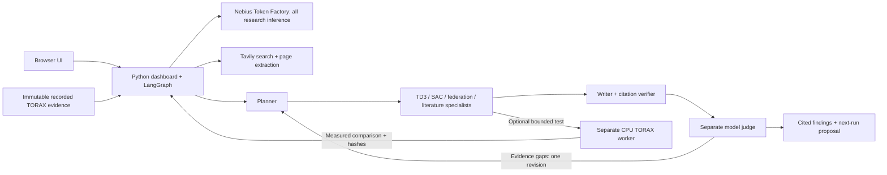

# Fusion Research Agent

A research agent that reads real TORAX/TD3/SAC experiment evidence, searches and
extracts literature with Tavily, and uses seven LangGraph model contexts through
Nebius Token Factory to produce a sourced critique and a next-experiment proposal.
An optional bounded shadow trial tests a single change with fresh controllers.

This is an executable research prototype. Live-provider and end-to-end validation
is ongoing; the repository does not imply that every proposed change improves RL.
The bundled measurements are recorded local CPU experiments, not newly run when
you open the app. No Nebius VM, NVIDIA GPU deployment or production reactor control
is claimed. The current shadow worker uses CPU and in-process aggregation.

## Run the app and inspect real evidence

Install Python 3.12 and [uv](https://docs.astral.sh/uv/getting-started/installation/).
From the repository root:

```sh
cd flower-app
uv sync --locked --extra research --extra dev
uv run --no-sync python dashboard.py
```

Open http://127.0.0.1:8787/#research. Select the two published shadow comparisons
and use offline inspection without credentials. These are real recorded
measurements; offline inspection does not use an LLM or search the web.
Read [the evidence provenance](examples/evidence/README.md).

## Run the seven-agent research workflow

Copy `flower-app/research.env.example` to `flower-app/.env.research` and configure
`NEBIUS_API_KEY` and `TAVILY_API_KEY` locally. Never commit that file. Choose a
tool-capable model available to your Token Factory account. Stop the local
dashboard before restarting it with the environment file:

```sh
cd flower-app
uv run --env-file .env.research --no-sync python scripts/verify_research_providers.py
uv run --env-file .env.research --no-sync python scripts/verify_research_judge.py
uv run --env-file .env.research --no-sync python dashboard.py
```

Ask: **Does the saved evidence justify claiming federation helps a cold-start
reactor, and which small experiment should we run next?** Select the real example
evidence and live mode. The trace records plans, search/extraction calls, findings,
citations and judgment. The judge can request a second research round or return
insufficient evidence. Exact quotations are checked against extracted pages;
experiment claims point into hash-verified JSON. Traceability alone is not proof
of semantic truth: inspect the judge's report and click the cited sources.

## Enable actual TORAX shadow trials

The app and RL worker deliberately use different virtual environments because
their Flower versions differ. The research UI can run without the RL environment.
To enable fresh numerical trials, run these commands from the repository root:

```sh
uv venv --python 3.12 .venv
uv pip install --python .venv torch==2.14.1 --index-url https://download.pytorch.org/whl/cpu
uv pip install --python .venv --constraint constraints-rl-cpu.txt -e ".[rl,dev]"
```

Do not install the legacy `fed` extra for shadow trials: Flower 1.22 requires
`click<8.2`, while the current TORAX/eqdsk dependency requires `click>=8.3.2`.
The shadow worker uses the numerical aggregation implementation and does not
require Flower network transport. Its runtime metadata records Flower as absent.
The legacy transport adapter is retained as reference code, outside this validated setup.

The constraints record the package versions of the CPU reference runtime; they
are not a complete transitive lock or a guarantee of identical cross-platform
numerics. The app has its own `uv.lock`. Root dependency resolution and platform
support must be verified before describing a new environment as reproduced.

In the research UI, prepare and start a shadow pilot, or explicitly enable one
shadow trial for a live agent run. A pilot freezes source, calibration and config,
then compares baseline/candidate across local, reset-only, uniform and clipped
arms. It uses real TORAX, TD3 and SAC. The default budget is 56 episodes and a
600-second wall limit; CPU resources remain shared with your other processes.
It does not load or modify existing experiments or apply a recommended policy.

## Architecture and scope



The facility-investigation sections retain the earlier Flower AgentApp and
reduced-model demonstrations. Those synthetic facilities are distinct from the
research agent's real TORAX experiment evidence. The Flower hosted-run button is
an optional separate workflow requiring the user's own Flower login; it is not
the Token Factory research inference path. This repository does not require a
Flower account for the research workspace.

See [RESEARCH.md](flower-app/RESEARCH.md) for tools, fairness checks and limits.
Each numerical pilot is developmental evidence. One seed cannot establish
federation efficacy, and endpoint cost is not shots-to-competence.

## Tests

From `flower-app`:

```sh
uv run --no-sync python -m pytest tests -q
```

Frontend tests use Node's built-in test runner; there is no npm install/build:

```sh
node --test tests/test_shadow_frontend.cjs
```

With the root RL environment installed, from the root:

```sh
uv run --no-sync python -m pytest tests/test_shadow_trial.py -q
```

Unit fixtures may use a synthetic plant; they are labelled and never substituted
for the live TORAX command. A successful unit suite is not a live-provider result.
The four 3D device views require WebGL and externally hosted pinned Three.js
scripts; ordinary controls remain available if those views cannot load.
