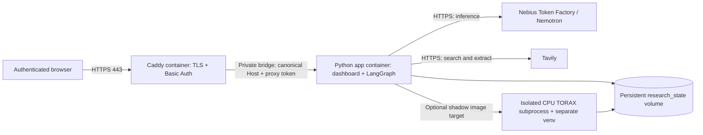

# Private Nebius AI Cloud deployment

This is a single-user deployment of the existing app. Browser traffic passes
through Caddy HTTPS and password authentication. The Python service runs the
LangGraph research workflow; inference remains on Nebius Token Factory and web
search/extraction remains on Tavily. The optional CPU TORAX worker uses a second
virtual environment inside the app container and freezes its own source and
outputs. It does not connect to or change the existing Kaggle experiments.



The Compose file exposes only ports 80/443. Every data/action route also requires
a private proxy token at the backend; spoofing forwarded headers is insufficient.
Writes retain the exact-origin and `X-Fusion-UI` checks. Authentication is for a
trusted individual, not a multi-tenant service. Anyone given the password can
start bounded research and shadow runs, so provider account quotas still matter.
The built-in HTTP server sits behind Caddy; this is a bounded hackathon deployment,
not a highly available service or a safety-critical reactor controller.

## What is verified

The Linux **research** image build and container/proxy smoke checks passed in
[GitHub Actions run 39138471875](https://github.com/wolfeiq/fusion-research-agent/actions/runs/39138471875)
for commit `2837fac587a87a07a731d8de199ef32db6df7eb6` (42 seconds). That run
tested the app's HTTP boundary and the real Caddy configuration on a
runner-loopback HTTP site with dummy credentials, without ACME or provider calls.
Missing/wrong login rejection, authenticated UI and research reads, spoofed-token
replacement, cross-origin rejection and stripping the browser's Authorization
header all passed. Caddy's HTTPS configuration also passed validation.

The subsequent local suite passed **1,308 tests**, with **2 skipped** and **2 warnings**.
Its HTTP coverage includes public-mode authentication, Host/Origin checks, typed
POST routing, local compatibility and a status-only health probe.

The initial Nebius VM deployment at `2837fac` also passed real HTTPS and login
checks: unauthenticated API requests returned 401, authenticated app/research/
shadow/health reads returned 200, and backend port 8787 was unreachable externally.
Caddy obtained a valid certificate. The CPU `shadow` image built and imported
TORAX, PyTorch and JAX successfully; physics execution inside that Linux image
has not yet been validated. Saved datasets are the default, and live generation
is explicitly experimental beta. A healthy server and available provider
configuration do not by themselves verify a live research report. Check the
workflow and acceptance results for the exact revision being deployed.

The default `research` image runs research against the committed evidence but
does **not** execute new TORAX trials. Choose `shadow` to install the optional RL
runtime. Its direct CPU constraints match the observed reference versions; they
are not a transitive Linux lock and must be validated on the VM. No GPU is needed
for this first deployment. NVIDIA model inference is provided by Token Factory;
this configuration does not provision a dedicated NVIDIA GPU or a Flower cluster.

## VM and network prerequisites

Use an authorized Nebius AI Cloud Linux x86-64 VM with Docker Engine and Compose
v2. A starting capacity for the CPU shadow demo is 4 vCPU, 16 GiB RAM and sufficient
disk for Torch/JAX images and retained results (for example 40 GiB free). These are
engineering starting values, not measured sizing guarantees. The research-only
image can use less. Confirm the available preset, project, region and spending
limit before creating resources; this repository does not automatically create
any cloud resource.

Provide a domain whose DNS A record points to the VM's public IP. Allow inbound
TCP 80 and 443; restrict SSH to the operator's address. Never expose 8787. Allow
outbound HTTPS for providers, image/package downloads and certificate issuance.
Keep the VM disk and Docker volumes persistent.

Nebius documents [creating a VM](https://docs.nebius.com/compute/virtual-machines/create)
and [connecting over SSH](https://docs.nebius.com/compute/virtual-machines/connect).
Caddy's [HTTPS quick start](https://caddyserver.com/docs/quick-starts/https)
describes DNS and inbound-port requirements; its
[Basic Auth documentation](https://caddyserver.com/docs/caddyfile/directives/basic_auth)
requires a password hash. Inference API credentials are separate from VM/project
access and cannot by themselves deploy this service.

## Configure on the VM

Use the public `fusion-research-agent` checkout. Do not copy a laptop `.dashboard`,
whole working tree or environment file into the build. Docker's default-deny
context allows public source, the calibration reference and published evidence;
it excludes private run state, virtual environments and secrets.

```bash
cp deploy/env.example deploy/.env
mkdir -p deploy/secrets
chmod 700 deploy/secrets
```

Edit `deploy/.env` with the actual domain, Token Factory base URL and model.
For shadow execution, set `FUSION_IMAGE_TARGET=shadow`. Keep the provider's allowed
model/output settings; a healthy HTTP server alone does not validate a model's
credentials or tool-calling support.

Generate a private proxy token locally on the VM without printing it:

```bash
python3 -c 'import pathlib,secrets; pathlib.Path("deploy/secrets/proxy_token.txt").write_text(secrets.token_urlsafe(48))'
chmod 600 deploy/secrets/proxy_token.txt
```

Create `deploy/secrets/nebius_api_key.txt` and `tavily_api_key.txt` using a secure
editor, each containing only its key. Do not put keys in shell command lines or
Git. Generate a login password hash interactively:

```bash
docker run --rm -it caddy:2.11.2-alpine caddy hash-password
```

Create `deploy/secrets/caddy_auth.txt` containing one line: `demo <generated hash>`.
The files are ignored by Git and never included in the Docker build context.
For local Compose file-backed secrets, the container's non-root UID must be able
to read the bind-mounted files: set them to mode 644 inside the mode-700 secrets
directory, or arrange equivalent read access for UID 10001. Parent directory
permissions keep other ordinary host users out; host administrators can read
these secrets. Compose mounts them only into the services that need them.

```bash
chmod 644 deploy/secrets/*.txt
docker compose --env-file deploy/.env -f deploy/compose.yaml config --quiet
docker compose --env-file deploy/.env -f deploy/compose.yaml up -d --build
docker compose --env-file deploy/.env -f deploy/compose.yaml ps
```

The first image build can take time; CPU wheels are large. Caddy obtains the
certificate automatically once DNS and inbound ports work. Visit the HTTPS domain
and log in. The browser never receives provider keys or the proxy token.

## Acceptance checks before calling it deployed

1. Confirm the app container is healthy and the proxy has obtained a valid TLS
   certificate. An unauthenticated request to `/api/research` must return 401;
   the same URL after login must show the research UI state.
2. Confirm port 8787 is unreachable externally, then inspect a published saved
   report and open its source and numeric evidence links.
3. Run one live research question with the configured providers. Verify the trace
   includes real retrieval, bounded decisions and a grounded publication or an
   explicit insufficient-evidence outcome. Health probes never test providers.
4. With the `shadow` target, confirm the UI reports the worker available. Start one
   bounded trial, inspect its manifest, source hashes, costs and result. A failed
   or timed-out worker is retained as a failure; do not label it a successful
   physics validation. Existing Kaggle execution is independent.

Reports, source snapshots, logs and worker outputs persist in `research_state`.
Do not use `docker compose down -v` unless intentionally deleting those records.
Back up that volume while idle. Upgrades and container restarts interrupt in-flight
research/worker processes; saved evidence remains, but interrupted jobs do not
resume training automatically. Wait until idle before upgrading. Keep one app
replica: job ownership is process-local and this deployment is not a distributed
queue.

For teardown, `docker compose ... down` removes containers while retaining named
volumes. Stopping containers does not release or stop the Nebius VM; manage the
VM separately in the cloud console and review its billing state.

Implementation references: [Docker Compose secrets](https://docs.docker.com/compose/how-tos/use-secrets/),
[Compose health checks](https://docs.docker.com/reference/compose-file/services/#healthcheck),
[uv in Docker](https://docs.astral.sh/uv/guides/integration/docker/).

## Deployed saved-data verification

The research-only UI and error-recovery changes are deployed at code revision
`94ad4babf48789e8cd5f251ac0d23547949f20a1`. Its Linux image and Caddy smoke checks
passed in [GitHub Actions run 39141449138](https://github.com/wolfeiq/fusion-research-agent/actions/runs/39141449138).
Real HTTPS, authentication, private backend access and the new UI asset checks
also passed on the VM.

Live run `92753c1d8f4b49d5b3e62296d98536dc` completed against the single saved TD3
critic-coordinate dataset using Nebius Token Factory and Tavily. All **44
verification checks passed**: the 12 required fact cards, all four competence
pairs, raw endpoint costs, source hashes and citation endpoints, and the recorded
keep-baseline recommendation with its 112-episode proposed budget. No new physics
was run and no experiment or aggregation policy was changed. The earlier partial
VM run is retained separately. See [the exact tested settings and question](verified_demo.md).

The primary TD3 paper excerpt is substantive methodological context about value
estimation error; it does not establish why this coordinate change helped or
prove a federation benefit. Successful reporting of one development dataset
is not independent RL confirmation or a guarantee against later provider errors.
Linux TORAX execution remains unvalidated and opt-in experimental beta.
