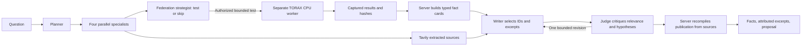

# Reporting integrity

The research agent now separates recorded findings from model interpretation.
The default report publishes server-generated facts, exact attributed literature
excerpts and validated recorded proposals. The model selects evidence; it cannot
write or rewrite the factual sentences that appear in the answer.

## Why the reporting path changed

Previously, the writer produced factual prose and citations, then a separate model
judge checked whether the citations supported that prose. Exact quote matching
caught invented numbers and broken offsets, but a valid quote could still be
used for the wrong claim. The judge sometimes accepted those scope errors. A
repair could also damage a citation that had already passed review.

The publication boundary now accepts fact IDs and excerpt selections. Server
code constructs the factual answer from the captured sources and checks the
selected configuration, numerical values and citations.



## Roles and authority

There are seven LangGraph agent roles: planner, TD3 specialist, SAC specialist,
federation strategist, literature researcher, writer and judge. The four
specialists work in parallel. When shadow testing is enabled, the federation
strategist then reads their findings and decides whether to run the single
permitted test. This decision is a second stage of that role, not another worker.

The writer selects immutable fact IDs and at most one offered excerpt ID from
captured sources. It cannot submit free quote text, anchors or offsets.
It can suggest explanations, but these remain explicitly **untested hypotheses**,
outside the factual answer. The judge can criticize the selection, reject a
hypothesis or request a bounded revision. Its approval cannot promote a hypothesis
into a measured result or certify scientific efficacy.

Optional hypotheses with unknown or unread source IDs are quarantined. They
are excluded from the displayed interpretations and retained as explicit
rejections in the trace; their references are never guessed, repaired or
treated as support. This change prevents an invalid optional explanation from
blocking otherwise valid evidence. Factual selections, exact citations and
proposal validation remain strict. Commit `6027357` implements this separation.

The final publication is rebuilt from the selected sources. Neither a changed
draft nor an accepting judge can replace its numbers, citations, configuration,
budget or provenance with model prose. No report automatically changes a policy
or launches its recommended next experiment.

## What the deterministic checks establish

- Each experimental fact binds to the exact captured source hash and JSON
  pointers. Unknown schemas, inconsistent records and missing required fields
  do not produce positive findings.
- Current shadow execution and saved historical trials have explicit provenance.
  Historical measurements cannot substitute for a missing result from the
  current worker. A failure before a comparison is produced remains reportable
  as a failure, without invented metrics.
- Paired raw endpoint cost differences are checked against the underlying
  baseline and candidate values for matching training seeds and evaluation
  conditions. Endpoint cost is not shots-to-competence. Repeating one seed does
  not create independent efficacy evidence.
- Clipping statements retain configuration, role, round, seed and critic
  identity. Counts and factors must agree with the recorded contributor norms
  and thresholds. Missing telemetry cannot become a claim of zero clipping.
- Raw learner results remain separate from gate-selected deployed diagnostics.
  A fallback result is not evidence that raw learning improved.
- Actual episode accounting is separate from a proposed budget and optimizer
  work. Gate, initial/fixed and report episodes are subsets of evaluation in
  the proposed protocol. Fractions are not silently labelled as percentages.
- Literature is shown as an exact attributed excerpt. Quotation accuracy does
  not establish that the paper applies to this controller. Broader interpretation
  remains a hypothesis, including transfers between centralized and federated
  settings or between different privacy definitions.
- The writer may select up to 12 facts. Configuration cards cover all seven
  registered change types and explicitly identify baseline and candidate
  values; absent configuration fields are not guessed.
- The required literature slot checks both a recognized publication URL/paper
  path and an extracted snapshot whose hash matches its content. Secondary
  summaries cannot satisfy that slot, including when the judge accepts them.
  Without an eligible excerpt, the report remains insufficient. This is a
  conservative location heuristic, not certification of authorship, peer review,
  scientific quality or relevance. The literature agent may extract an already
  discovered eligible page on its last turn without receiving extra turns.

## Verification and limits

The full app suite passed **1,178 tests** with two skips and two existing
Typer/Click warnings in 27.53 seconds; Ruff also passed. The frontend suite passed
**52 tests**. These checks cover evidence binding, malformed and adversarial inputs,
current versus historical selection, failed workers, raw versus deployed
results, report reconstruction, proposal accounting and UI separation of facts
from hypotheses. Mock-provider tests exercise the actual LangGraph path and an
overly accepting judge; a permissive judge still cannot author published facts.

The configuration extension passed 127 focused tests; the primary-reference,
writer and graph checks passed 84 focused tests. These are separate invocations,
not counts to add to the full suite.
The excerpt catalogue passed 23 direct tests; an independent focused run passed
81 tests. These checks cover bounded generation, exact citation validation,
source binding and question-preserving reconstruction; they are also separate
invocations, not additional independent coverage.

A further 53 targeted service tests cover failure diagnostics and Windows state
publication. Commit `08dfbec` retains the exception class, up to 12 bounded code
locations and numeric OS error codes, without exception messages, full paths,
source text, provider payloads or locals. State-file replacement retries only
Windows access/sharing/lock errors 5, 32 and 33: at most six attempts and 0.31
seconds of scheduled delay per replacement. Permanent errors still fail, and
previous state is not deleted.

Full attempt 23 (`90c553019d654f2c966882cd10d240fd`) produced no report: the writer
exhausted its bounded selection attempts because optional hypotheses referenced
unknown or unread sources. Its isolated shadow completed 56 episodes in 98.468
seconds, and all 57 protected source hashes were preserved. Successful numerical
execution does not make that research attempt a successful answer. The quarantine
change addresses this failure without weakening factual validation.

Attempt 24 (`9bcfc668aecd4b17a2e8608882747e1f`) subsequently recorded a response-processing
failure, with no report or current shadow source. No traceback was retained,
so its cause remains unproven. A transient file lock is a hypothesis only;
the new diagnostic path cannot retrospectively establish it. Attempt 24 is not
counted as a completed end-to-end run.

**Live attempt 25 (`2208045d8aea469690a67d442dec46c2`) passed 35 independent
reporting and integrity checks.** The complete run exercised all seven agent
roles with Nebius inference, Tavily search/extraction and shadow
`b4838455d2a0460d8007314be78af07a`, which completed 56 real TORAX episodes in
93.469 seconds. All 57 protected source files matched, and all endpoint mean
costs were recomputed exactly from the saved rewards.

The publication contains eight server-authored fact cards: seven cite the current
shadow, and one gate observation is explicitly labelled historical. It includes
one exact 25-word PMLR paper excerpt and a current-source follow-up proposal for
112 episodes: 64 training plus 48 evaluation. The 16 gate, 8 initial/fixed and
24 report episodes are subsets of those 48 evaluations. No hypothesis was
published as a factual claim; this run submitted no hypotheses. No policy was
automatically activated.

This pass establishes the integrity of this bounded live reporting workflow.
Repeating development seed 17 does not provide an independent cold-start result.
The audit does not validate simulator physics, experimental design, real-reactor
safety, source applicability in every setting or a general federation benefit.
All 24 preceding attempts remain in the verification log. No-shadow check 26
correctly retained four unfavorable cost differences and the baseline, but its
exact TinyCTO secondary excerpt and omitted setting/competence details left the
answer incomplete. Commits `e720987` and `6496e1b` address the configuration and
primary-reference gaps. Check 27 then retrieved primary TD3 and Henderson papers,
but all three writer selections failed because the requested anchor did not fit
its chosen word limit. No new physics ran and no report was published.

Commit `19d08c4` implements the server-built catalogue of valid, immutable
literature excerpt IDs. Each offered entry is hash-bound and validated through
the exact citation helper before selection. The writer may select at most one
entry, with no free quote, anchor or offset fields. Generation is bounded to
12 entries per source and 48 total, considering at most 128 candidates and
making at most 24 citation-helper calls per source. Final reconstruction uses
the original question and captured sources, preserving the offered IDs.

The implementation passed automated checks. Same-question live check 28
(`6792cb0daad24ac38f12c717755d320b`) then passed 41 independent factual/reporting
checks without launching a shadow. It produced 12 exact facts from the explicitly
labelled saved unfavorable pilot: TD3 actor learning rate 0.0001 to 0.00005, all
four positive candidate-minus-baseline cost differences (worse performance) and
all four false/false competence comparisons. Its exact 25-word excerpt from the
Fujimoto TD3 PMLR paper concerns multi-seed evaluation; it does not establish that
the learning-rate change helps. The one model-generated improvement hypothesis
was marked critic-rejected and stayed outside the factual answer.

Check 28 used 18 model calls, 248,374 recorded tokens, three searches, four
extractions and 15 tool calls, with zero selection rejections. Its recommendation
keeps the baseline. The 112-episode proposal (64 training plus 48 evaluation)
would repeat the losing candidate on development seeds 29 and 43 for diagnosis;
it was not launched and does not approve adopting the candidate. No new physics
or current experiment changes occurred.

These are two scoped reporting passes, not a guarantee of autonomous scientific
reliability. Check 27 remains failed. The public records for
[attempt 25](../examples/verification/reporting_check.json) and
[negative check 28](../examples/verification/negative_reporting_check.json)
preserve the audits. The positive record is an explicit projection with two
local sources, eight facts, 35 checks and one 25-word excerpt, not the full trace
or bulk copyrighted web text. The negative record contains 12 facts, 41 checks,
manual review, the proposal and one 25-word excerpt; it adds no experiment source
snapshots. Its references bind to the already-public unfavorable-pilot comparison
at commit `f0a0174`. The paper excerpt ends mid-sentence at “perform”; it is an
attributed fragment, not a complete sentence. Optional gap notes remain unverified
model observations and are not factual findings.

Follow the root [README](../README.md) for installation, local provider
configuration, the app and separate CPU worker environment. After installing
the app's development dependencies, run the app checks from `flower-app`:

```sh
uv run --no-sync python -m pytest tests -q
node --test --test-isolation=none tests/test_shadow_frontend.cjs
```

Research inference uses Nebius Token Factory; web search and extraction use
Tavily. The app and TORAX shadow worker run locally. This change does not deploy
a Nebius VM, an NVIDIA GPU service or a production reactor controller.
