# How the research team and shadow experiment work

The research team studies a question, checks saved experiment results against
literature, and recommends a next experiment. When shadow testing is enabled,
it can also measure one small proposed change in a fresh TORAX simulation before
writing its recommendation. A completed simulation and a well-supported report
are separate requirements.

| Term | What it means here | Where it runs |
|---|---|---|
| Research agent/team | Seven LLM roles: planner, TD3 specialist, SAC specialist, federation strategist, literature researcher, writer and judge | LangGraph orchestration in the local app; model inference on Nebius Token Factory; web search and extraction through Tavily |
| Shadow test | A bounded comparison of the frozen baseline configuration and one candidate change, away from existing experiment state | Requested through the app's `ShadowService` |
| Worker | The Python process that actually trains controllers, runs TORAX, aggregates critic updates and records measurements | A separate local CPU process using the root RL Python environment, JAX/TORAX and PyTorch |
| RL controller | The learned TD3 heating controller or SAC microwave-deposition controller acting inside the simulation | Inside the worker, alongside TORAX |

The LLM agents choose and interpret a permitted test. The RL controllers learn
through simulated interactions. Token Factory inference does not execute those
physics or training steps.

```mermaid
flowchart LR
    Q[Question + selected saved evidence] --> R[Planner + four parallel researchers]
    R --> D[Federation strategist: test or skip]
    D -->|Opt-in: one bounded attempt| S[Freeze source, calibration and configuration]
    S --> W[Local CPU worker: baseline + candidate]
    W -->|Measured results + hashes| A[Writer + citation checks]
    D -->|Evidence and decision| A
    A --> J[Separate judge context]
    J --> O[Reviewed recommendation or insufficient evidence]
    J -->|Bounded revision| A
```

## What the small experiment compares

Both configurations use paired seeds and the same simulation conditions. The
candidate changes exactly one registered setting, such as an actor learning rate,
critic blend fraction or clipping threshold. Each configuration includes:

| Control | Purpose |
|---|---|
| `local` | Target learns from its own experience |
| `reset_only` | Target receives the local repair/reset procedure without donor aggregation, separating that procedure from transfer |
| `uniform` | Equal averaging of compatible critic-representation deltas |
| `clipped` | The same aggregation with each contributor's delta norm capped separately for each role and critic branch |

TD3 shares with TD3 and SAC with SAC; critic branches `q0` and `q1` remain separate.
Actors, replay and other local learner state are not pooled. Two simulated donors
start cooler and warmer than the target. This is a one-way transfer pilot: donors
supply updates, while the target continues learning. Aggregation executes
numerically inside the worker; this test does not exercise Flower network transport.

The research tool fixes **seed 17, one round and one attempted trial per research
run**, including failed attempts. Across baseline and candidate, that is **56
episodes: 32 training and 24 evaluation**, with up to **1,680 action windows** and
a **600-second worker limit**. Donor training and gate evaluations are included;
replay-only optimization is recorded separately. Earlier calibration is additional
sunk cost. The broader manual shadow interface permits up to three seeds and two
rounds; that is not the agent tool's default budget.

## How existing work is protected

Before launch, the service copies the required source and calibration bytes into
a unique trial directory and records their hashes, configuration and expected
budget. The worker imports that frozen source, creates fresh controllers and
writes its own outputs. It does not resume or overwrite existing checkpoints.
An execution lease prevents duplicate workers; failures and partial outputs are
retained. This is process and file isolation, not an operating-system security
sandbox: CPU and memory are still shared with other local work.

## Why measurement and judgment both matter

Mechanical checks verify source identity, exact JSON pointers, quotations and
recorded numerical comparisons. They can prove that a cited value occurs in the
source; they cannot prove that a sentence interprets it correctly. The separate
judge context examines support, fairness, missing evidence and proposal budgets.
That judge is also a model and can miss errors, so independent human/source review
remains necessary for scientific claims.

Read **raw learner performance separately from gate-selected fallback**. A gate
can retain the incumbent when the new candidate performs poorly; its displayed
`deployed` result is a diagnostic selection, not a separately trained deployment
branch. Also distinguish endpoint cost, beta_N tracking and temperature-profile
error. One seed's endpoint difference cannot establish cold-start speedup,
shots-to-competence or a general federation advantage. The output is a proposal
for another reviewed run; it does not install changes into current experiments.

Implementation: [agent graph](../flower-app/fusion_agent/research/graph.py),
[typed research tools](../flower-app/fusion_agent/research/engine.py),
[shadow service](../flower-app/fusion_agent/research/shadow.py),
[numerical worker and budget](../scripts/run_shadow_trial.py),
[comparison analysis](../flower-app/fusion_agent/research/shadow_analysis.py),
[citation verification](../flower-app/fusion_agent/research/verification.py).
