# How the research team and shadow experiment work

The research team studies a question, checks saved experiment results against
literature, and recommends a next experiment. When shadow testing is enabled,
it can also measure one small proposed change in a fresh TORAX simulation before
writing its recommendation. A completed simulation and a well-supported report
are separate requirements.

| Term | What it means here | Where it runs |
|---|---|---|
| Research agent/team | Seven LLM roles: planner, TD3 specialist, SAC specialist, federation strategist, literature researcher, writer and judge | LangGraph orchestration in the local app; model inference on Nebius Token Factory; web search and extraction through Tavily |
| Shadow test | A bounded comparison of the frozen baseline configuration and one candidate change, away from existing experiment state | Requested through the app's `ShadowService` |
| Worker | The Python process that actually trains controllers, runs TORAX, aggregates critic updates and records measurements | A separate local CPU process using the root RL Python environment, JAX/TORAX and PyTorch |
| RL controller | The learned TD3 heating controller or SAC microwave-deposition controller acting inside the simulation | Inside the worker, alongside TORAX |

The LLM agents choose and interpret a permitted test. The RL controllers learn
through simulated interactions. Token Factory inference does not execute those
physics or training steps.

```mermaid
flowchart LR
    Q[Question + selected saved evidence] --> R[Planner + four parallel researchers]
    R --> D[Federation strategist: test or skip]
    D -->|Opt-in: one bounded attempt| S[Freeze source, calibration and configuration]
    S --> W[Local CPU worker: baseline + candidate]
    W -->|Measured results + hashes| F[Server builds typed fact cards]
    F --> A[Writer selects fact IDs and exact excerpts]
    D -->|Evidence and decision| A
    A --> J[Judge critiques relevance and hypotheses]
    J --> B[Server recompiles publication from sources]
    B --> O[Facts, attributed excerpts and proposed next run]
    J -->|One bounded selection revision| A
```

## What the small experiment compares

Both configurations use paired seeds and the same simulation conditions. The
candidate changes exactly one registered setting, such as an actor learning rate,
critic blend fraction or clipping threshold. Each configuration includes:

| Control | Purpose |
|---|---|
| `local` | Target learns from its own experience |
| `reset_only` | Target receives the local repair/reset procedure without donor aggregation, separating that procedure from transfer |
| `uniform` | Equal averaging of compatible critic-representation deltas |
| `clipped` | The same aggregation with each contributor's delta norm capped separately for each role and critic branch |

TD3 shares with TD3 and SAC with SAC; critic branches `q0` and `q1` remain separate.
Actors, replay and other local learner state are not pooled. Two simulated donors
start cooler and warmer than the target. This is a one-way transfer pilot: donors
supply updates, while the target continues learning. Aggregation executes
numerically inside the worker; this test does not exercise Flower network transport.

The research tool fixes **seed 17, one round and one attempted trial per research
run**, including failed attempts. Across baseline and candidate, that is **56
episodes: 32 training and 24 evaluation**, with up to **1,680 action windows** and
a **600-second worker limit**. Donor training and gate evaluations are included;
replay-only optimization is recorded separately. Earlier calibration is additional
sunk cost. The broader manual shadow interface permits up to three seeds and two
rounds; that is not the agent tool's default budget.

## How existing work is protected

Before launch, the service copies the required source and calibration bytes into
a unique trial directory and records their hashes, configuration and expected
budget. The worker imports that frozen source, creates fresh controllers and
writes its own outputs. It does not resume or overwrite existing checkpoints.
An execution lease prevents duplicate workers; failures and partial outputs are
retained. This is process and file isolation, not an operating-system security
sandbox: CPU and memory are still shared with other local work.

## Why measurement and judgment both matter

The server builds descriptive fact cards from recognized, hash-bound experiment
schemas. It checks paired arithmetic, evaluation conditions, clipping records
and actual accounting, then supplies exact source citations. The writer chooses
card IDs and at most one prevalidated literature excerpt ID rather than writing
factual claims, quote text, anchors or offsets. The server rebuilds the final
answer from those selections using the original question and captured sources.
Up to 12 fact cards can include the baseline/candidate settings for all seven
registered change types. The required literature slot accepts extracted,
hash-bound pages at recognized paper URLs; secondary summaries do not fill it.
Missing eligible literature yields insufficient evidence. This location check
does not establish authorship, scientific quality or applicability.

The judge critiques relevance, missing evidence and untested hypotheses. Its
approval cannot change a recorded fact, invent a result or establish that a
paper applies to the controller. Optional hypotheses with unknown or unread
source references are quarantined, traced and excluded from the displayed
interpretations. Their references are not repaired. The factual checks stay
strict, and a failed current worker is not replaced with a historical result.

One complete live run of this reporting path passed 35 independent checks:
seven Nebius-backed roles, Tavily retrieval, a real 56-episode TORAX shadow and
a source-bound report. Its eight fact cards clearly separate seven current
observations from one historical gate observation. Local tests also exercise
an overly accepting judge and malicious report mutations. Neither this one
live pass nor the tests guarantee useful selections for every question or
scientific validity. See [reporting integrity](reporting_integrity.md) and the
retained failures in the [verification log](verification_log.md).
The later negative check 27 retrieved primary papers but produced no report:
its three excerpt-anchor selections exceeded their requested word limits.
The server-built immutable excerpt catalogue was implemented in commit
`19d08c4`. The same-question live check 28 passed 41 independent factual/reporting
checks: all requested learning-rate settings, four unfavorable cost comparisons
and four competence comparisons were preserved; an unsupported improvement
hypothesis was critic-rejected. The exact TD3 paper excerpt supports fair
multi-seed evaluation, not the candidate's efficacy. It read saved evidence and
launched no new physics. The recommendation keeps the baseline; its further
112-episode diagnostic proposal was not launched. These reporting passes do not
guarantee autonomous scientific reliability.

Read **raw learner performance separately from gate-selected fallback**. A gate
can retain the incumbent when the new candidate performs poorly; its displayed
`deployed` result is a diagnostic selection, not a separately trained deployment
branch. Also distinguish endpoint cost, beta_N tracking and temperature-profile
error. One seed's endpoint difference cannot establish cold-start speedup,
shots-to-competence or a general federation advantage. The output is a proposal
for another reviewed run; it does not install changes into current experiments.

Implementation: [agent graph](../flower-app/fusion_agent/research/graph.py),
[typed research tools](../flower-app/fusion_agent/research/engine.py),
[shadow service](../flower-app/fusion_agent/research/shadow.py),
[numerical worker and budget](../scripts/run_shadow_trial.py),
[comparison analysis](../flower-app/fusion_agent/research/shadow_analysis.py),
[typed fact builder](../flower-app/fusion_agent/research/grounded_facts.py),
[publication boundary](../flower-app/fusion_agent/research/grounded_publication.py).
