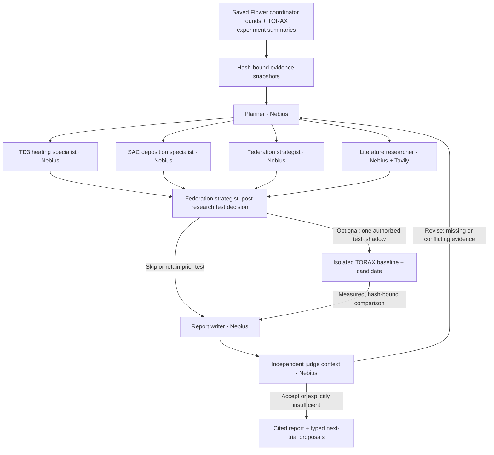

# Fusion Research Advisor

A research workspace connected to the saved federation-round artifacts of the
existing TORAX/Flower TD3/SAC architecture. Specialist agents inspect the actual
aggregation and controller evidence, perform bounded clipping calculations,
retrieve primary literature through Tavily and draft typed next-trial proposals.
With an explicit per-run opt-in, the federation strategist can also test one
bounded candidate in a fresh, isolated local TORAX shadow experiment. Existing
controllers, checkpoints and active federation rounds are not changed.

## Seven agents, orchestrated by LangGraph



These are seven agent roles and real LangGraph nodes. Four researchers
run in parallel. When shadow testing is enabled, a second federation-strategist
stage receives all four findings and their actual source snapshots before choosing
whether to test. Its decision has a separate context, requires its own evidence
read, and may explicitly skip a test. Testing is unavailable during parallel
research. Without shadow testing, the four branches go directly to the writer.
The judge reviews every claim and every
proposal. It scores citation support, experimental fairness, actionability and
honesty about scope on a descriptive 0–2 rubric. Scores are model judgments,
not probabilities: 0 means unmet, 1 partially met, and 2 met. Acceptance requires
all four valid scores, no zero scores, supported claims and adequate proposals.
A second research round is allowed; after that, unresolved
evidence is reported as insufficient. The graph does not automatically accept
because a retry limit was reached.

The planner assigns distinct TD3, SAC, federation and literature questions. The
TD3 specialist examines heating drift, critic scaling and repair work; the SAC
specialist examines deposition control, entropy and its dependence on the TD3
power budget. The federation strategist inspects role-matched critic sharing and
tests clipping arithmetic against recorded norms. The literature researcher
chooses searches and pages to extract. The writer
states whether evidence is sufficient and submits a structured report. The
judge can demand more research. The trace records public decisions, tools,
sources, revisions and usage; it does not expose private model reasoning.

## Relationship to the existing architecture

- **TORAX/Flower RL:** existing training, aggregation, gates and evaluations.
- **Existing Flower AgentApp:** its own facility investigation workflow remains
  available under the original app sections.
- **Research workspace:** a local dashboard service using Token Factory directly
  for all inference. Its artifact adapter reads frozen manifests, job contracts
  and the scalar metadata in coordinator NPZ archives. It connects recommendations
  to specific roles, rounds, source hashes and observed controls. Actors, replay,
  credentials and raw trajectories remain outside this service. Literature
retrieval goes through Tavily. Optional shadow work runs in a separate process
using the repository's RL environment and a private source snapshot; its bounded
result summaries return to the research workspace as evidence.

The current experiment's configuration is not edited. Recommendations include a
hypothesis, changes, controls, metrics, budget, stop rule, citations and limitations.
A typed trial proposal records one exact candidate change and its implementation
prerequisites; it is not itself executable. The separate shadow interface accepts
only a registered, bounded configuration change. It has no general shell tool,
Kaggle submission API or mechanism for installing a policy into an active run.

## Tools connected to the federation evidence

| Tool | Actual operation | Boundary |
|---|---|---|
| `inspect_federation` | Read a selected captured dossier: manifest, TD3/SAC role channels, separate q0/q1 critic branches, round acknowledgements, raw costs, gates and optimizer work | Saved artifacts; no live controller access |
| `compare_clipping` | For one recorded job and round, calculate norm-cap factors and activation at threshold scale 0.5, 1 or 2; calculate upper bounds on mean-update norms | No donor update directions, tensor reaggregation, rollout or predicted control improvement |
| `draft_policy_trial` | Validate one bounded configuration change against the captured manifest; return the recorded/candidate values, retained controls and implementation prerequisites | Proposal only; no configuration write, completed trial or permission to launch |
| `test_shadow` | When enabled for the live research run, freeze and run one new local baseline/candidate TORAX pilot and return its measured comparison | Federation strategist only; requires prior evidence reading; one attempt, seed 17, one round; no active-run mutation or policy installation |
| `cite_experiment_value` | Resolve an array of existing JSON keys/indices into an exact escaped pointer and canonical quotation | Writer; already-read experiment only; no path evaluation, new evidence or semantic endorsement |

TD3 and SAC specialists can read summaries and inspect dossiers. The federation
strategist additionally gets the calculation/proposal tools and, when explicitly
enabled, `test_shadow`. Results become
new hash-bound evidence snapshots that the writer and judge can cite. The judge
receives sources referenced only by next-trial proposals as well as claim sources.

The recorded policy keeps heating and deposition in different channels and their
two critic trunks separate. Actors, heads, targets, replay and optimizers stay
local. Uniform metadata may contain only base/proposal hashes. The tool reports
missing source norms as **unavailable**, never as zero. Norms alone cannot recover
donor deltas, their directions or conflict, or establish a better aggregate.

Typed proposals against the original study runner distinguish these implementation
states. The separate shadow runner supports all seven fields without editing that
original runner:

| Proposed field | Current implementation support |
|---|---|
| `heating_critic_coordinates` | Current runner CLI: `--heating-critic-coordinates physical\|normalized` |
| `clipping_initial_norm_fraction` | `StudyConfig` supports it programmatically; no current CLI option |
| `td3_mix`, `sac_mix`, `td3_actor_lr`, `sac_actor_lr`, `sac_alpha_lr` | Runner changes and tests are required before launch; these fields are currently fixed in `learner_configs` |

Every proposal preserves the recorded comparison controls, including local,
reset-only, initial-base pull, raw federation, deployed gate behavior, joint SAC
and fixed calibrated commands. Its budget copies the **recorded** matrix and
explicitly sets the candidate budget to **not recomputed**. The whole baseline
and candidate cost must be recomputed before any trial, including donors, target
shots, evaluation, repair updates and calibration. An old manifest missing a
field requires establishing its actual historical baseline before comparison.

## Real isolated shadow experiments

The dashboard can prepare and start a shadow pilot without model credentials.
A live seven-agent run can use the same service only when **Allow one shadow
trial** is enabled for that run. It is off by default. The agent must first read
an experiment source; only the federation strategist receives the tool. Failed
attempts consume its one-attempt allowance too. Research output may recommend a
follow-up, but it never automatically starts the next experiment or applies a
policy.

The manual pilot accepts one to three paired development seeds and one or two
rounds. The agent tool fixes seed 17 and one round. Each pilot compares a fixed
baseline with a single registered candidate change: TD3/SAC actor learning rate,
SAC entropy learning rate, TD3/SAC critic blend fraction, initial-norm clipping
fraction, or TD3 critic action coordinates. It uses actual TORAX episodes, TD3
and SAC updates, two donor controllers, and local, reset-only, uniform and clipped
arms. Donor training, target training, gate/report evaluations and optimizer work
are accounted for. The default one-seed/one-round matrix has **56 episodes**
across baseline and candidate, with a 600-second wall limit and Torch/BLAS thread
limits of one. JAX may use additional runtime or compilation threads; CPU
resources remain shared with other local work.

This is a new bounded numerical experiment. It uses in-process aggregation,
not Flower network transport, and fresh controllers rather than the current
experiment's checkpoints. Its small simultaneous-update schedule differs from
the main alternating-training study. It does not include the main study's full
joint-SAC, initial-base-pull and fixed-command comparison matrix. The deployed
branch is a gate-selected report, not a separately trained longitudinal policy;
the raw learner continues independently of that gate decision.

Preparation freezes source files, calibration, configuration and a manifest under
`flower-app/.dashboard/shadow/<32-hex-trial-id>/`. The worker runs from that source
snapshot and writes only its own output directory. This isolates code, learner
state and outputs; CPU resources remain shared with the laptop's other work.
The process has a hard wall limit; no live policy installation is possible.

The service saves `output/result.json`, `comparison.json`, `manifest.json`,
`config.json`, `source.zip`, progress and failure records. The evidence catalogue
lists the latest eight `comparison.json` records. It verifies exact result/source
archive hashes, frozen manifest/config identity, terminal run status and the
comparison arithmetic before making a snapshot. It never loads a checkpoint.
These snapshots have schema `fusion-shadow-comparison-v1`, adapter
`shadow_comparison`, and a 70,000-character limit. Hash verification and summary
recomputation do not constitute a second raw trajectory audit.

The comparison pairs training seeds and recorded physical conditions, keeps
failed/missing cases visible, and separates raw endpoints from gate-selected
outputs. It reports cost, beta_N tracking error and temperature-profile RMSE
separately. Incomplete or unstable learning prompts diagnosis; worse raw outcomes
retain the baseline; lower observed costs prompt more paired seeds. One seed
never establishes efficacy, and these sparse endpoint checks never establish a
shots-to-competence speedup. The original proposal's copied historical budget
remains **not recomputed**; the shadow experiment has its own newly frozen budget.

Completed, valid comparisons also return a concrete `next_run_proposal`: repeat
the **same** candidate change and round count on the next two seeds in
`17, 29, 43, 59, 71` that were absent from that trial. Positive, null and negative
outcomes follow the same rule; no new knob is chosen to manufacture a win. This
is an unlaunched request with a newly calculated episode budget, not permission
to run. The development/confirmation ledger must still be checked because the
proposal only knows the selected trial's seeds. Failed, unstable or unfair
comparisons return a null request and require diagnosis first.

### First actual TORAX shadow pilot

Trial `993df979e388405297f0195bfca504d6` completed **56 TORAX episodes / 1,680
action windows in 141.125 seconds** on the local CPU. It compared TD3 actor
learning rate `0.0001` with `0.00005`, holding the paired seed at 17 and running
one transfer round. Both TD3 and SAC performed learning updates. The raw
reporting endpoints were:

| Configuration | Arm | Cost | beta_N MAE | Te profile RMSE, keV |
|---|---|---:|---:|---:|
| Baseline | Local | 0.112699 | 0.00262930 | 0.0404901 |
| Baseline | Reset-only | 0.0964242 | 0.00202309 | 0.0310107 |
| Baseline | Uniform = clipped | 0.0962897 | 0.00202197 | 0.0308953 |
| Lower TD3 actor rate | Local | 0.116176 | 0.00274710 | 0.0421791 |
| Lower TD3 actor rate | Reset-only | 0.106152 | 0.00243351 | 0.0367959 |
| Lower TD3 actor rate | Uniform = clipped | 0.105933 | 0.00243113 | 0.0366386 |

The lower actor rate worsened all three metrics in every arm. Baseline federation
had 14.56% lower endpoint cost than local, but only **0.1395% lower than reset-only**:
most of that apparent gain is also achieved by local reset/repair. Clipping never
activated, and uniform/clipped proposal hashes and endpoint metrics matched.
All federation gates accepted, so raw and deployed endpoint metrics matched here.
None of the eight raw endpoints met the combined competence rule: every profile
RMSE exceeded 0.02 keV, despite beta_N MAE being below 0.005. This is one seed and
one reporting condition; it demonstrates working execution, not reliable
federation benefit or cold-start speedup.

An independent read-only audit checked all 56 saved episodes for completion,
30-window lengths and recorded errors/events, recomputed reward-sum costs, and
recomputed cost, beta_N MAE and interpolated profile RMSE for all eight raw
endpoints. They matched the worker summaries within `1e-12`; the two initial
critic-representation hashes matched across configurations. Each configuration
used eight donor-training shots, eight target-training shots, four gate shots,
six report shots, one initial evaluation and one fixed-command evaluation.
Prior calibration work remains additional; contribution fitting and repair
optimizer work are recorded separately.

Local evidence lives in `flower-app/.dashboard/shadow/993df979e388405297f0195bfca504d6/`.
The immutable worker result SHA256 is
`308ec8e3304189c229878995f7ecb6a5b632f63ea588817f69b6b9edbc528063`;
source archive SHA256 is
`9520548f718f756e75c8f30a83e76da4c5d7cc128eaca2d9cbc5097c05845a7c`.
The recommendation retains the baseline and proposes repeating the same
`td3_actor_lr=0.00005` comparison on seeds **29 and 43**, one round: **112
episodes** (64 training, 48 evaluation), at most 3,360 windows and 600 seconds.
That proposal has not launched. Keep the negative seed-17 outcome in the record.

## Registered runs and diagnostic records

The federation adapter currently registers exactly two runs:

| Catalogue ID | Registered artifact directory |
|---|---|
| `federation:local-smoke` | `results/coldstart_federation_live_smoke/` |
| `federation:kaggle-359552340` | `results/coldstart_kaggle_audit/359552340/output/coldstart_federation_job/study/` |

Within each registered directory it reads `manifest.json`, saved study state and
summary, and declared jobs' `job.json`, `summary.json`, `coordinator.npz` and
`coordinator-checkpoints.json`. For an observed round it checks the exact
`coordinator-round-N-proposal.npz` or `coordinator-round-N-acknowledged.npz`
archive against the saved hash record. Only the bounded `metadata.npy` scalar is
decoded from an NPZ; critic tensor arrays and trusted pickle checkpoints are
not loaded. The dossier checks role/schema separation, consumed update IDs,
base/proposal hash chains and full-cohort acknowledgements. A pending proposal
does not count as an acknowledged round. Individual reads and the final input
set must remain stable during capture.

Snapshots use schema `fusion-federation-dossier-v1` and expose exact JSON pointers,
for example `/jobs/0/rounds/0/acknowledgements/cold_target/raw_costs/raw_federated/0`.
Their metadata identifies `adapter: federation_dossier` and lists each input
file's repo-relative path and SHA256. A dossier is limited to 70,000 characters;
the total selected source content is limited to 100,000 characters.

Two additional diagnostic records are separately selectable:

- `results/coldstart_learning_diagnostic/checkpoint_probe.json`: reconstructed
  network and action-gradient probes from saved checkpoints, not historical
  optimizer-gradient logs.
- `results/td3_heating_stability/conditioning_probe/results.json`: saved-critic
  sweeps plus explicitly synthetic quadratic-regression results. Synthetic
  labels are not TORAX rewards or a federation efficacy experiment.

These records are not automatically attached to a federation dossier or treated
as evidence for its version. The agent must inspect their provenance and scope;
a shared directory or plausible mechanism does not establish a causal connection.

## Install and open

From the repository root, using the app environment (not the RL environment):

```powershell
cd flower-app
uv sync --extra dev --extra research --frozen
uv run --extra research python dashboard.py
```

Open `http://127.0.0.1:8787/#research`. If another instance uses that port, start
with `python dashboard.py --port 8790` and use that port.

Before credentials are configured, **Inspect local evidence** runs deterministic
inspection of the selected saved records. For each selected federation dossier,
it inspects the latest saved round of **every recorded job with round evidence**
and computes `compare_clipping` at threshold scale **1**. It surfaces inactive
clipping and unavailable metadata; failed or unrecorded jobs remain visible in
the dossier. It calls neither an LLM nor Tavily and drafts no policy proposals.
The run is explicitly labelled offline.

Configure these variables in the server's environment, then restart the server.
The existing ignored `.env.research` file can be loaded with:

```powershell
uv run --env-file .env.research --no-sync python dashboard.py
```

The file is a local secret file; never add it to the repository or evidence exports.

| Variable | Purpose | Default |
|---|---|---|
| `NEBIUS_API_KEY` | Token Factory credential | Required for live mode |
| `NEBIUS_BASE_URL` | OpenAI-compatible HTTPS endpoint, including `/v1` | `https://api.tokenfactory.nebius.com/v1` |
| `NEBIUS_MODEL` | Tool-capable model ID from your account's catalogue | Cookbook default `MiniMaxAI/MiniMax-M3` |
| `NEBIUS_MAX_OUTPUT_TOKENS` | Per-response output cap, integer 256–16,000 | `5000`; dedicated Nemotron verification uses `12000` |
| `NEBIUS_ENABLE_THINKING` | Optional model-specific `chat_template_kwargs.enable_thinking`; `true` or `false` | Unset preserves the provider default; verified dedicated endpoint currently uses `false` |
| `TAVILY_API_KEY` | Search/extraction credential | Required for live mode |
| `TAVILY_BASE_URL` | Tavily HTTPS API root | `https://api.tavily.com` |

Keys stay on the server and are not part of browser responses, reports, source
snapshots or Git. Do not put keys in questions. The browser displays credential
presence, not values. Custom endpoints must use HTTPS without URL credentials
or query parameters. No automatic provider calls occur when opening the page.

For the first live run, select the local-smoke federation dossier, the incomplete
Kaggle federation dossier and the repair comparison. Ask:

> Does the saved evidence justify claiming federated TD3/SAC accelerates
> cold-start reactor control? Did clipping actually change the recorded updates,
> and what small, fair policy comparison should we run next?

The selected summaries and question are sent to the configured Nebius endpoint.
General scientific search queries are sent to Tavily. The model is instructed
to avoid private details in searches; this is not a formal information-flow
guarantee. Use shareable summaries for the hackathon.

## Evidence and judging

Each research run captures immutable snapshots with a SHA256 of the exact displayed
content. Summary snapshots also retain the original source-byte hash; federation
dossiers retain the hash of every input file. The allowlist admits specific
summary/protocol files, the two registered federation roots and verified shadow
comparisons. Large analyses may be projected; omitted
JSON pointers and redacted absolute paths are disclosed. Invalid/changing files
are rejected. A saved audit's `complete_verified` label is reported evidence,
not a fresh audit of trajectories or current Kaggle job status.

An experiment citation must name a collected source, an exact JSON pointer and
a matching quotation. Web claims require a page extracted through Tavily;
search snippets alone are insufficient. Source snapshots and links are visible
in the UI. Model-provided HTML is rendered as text. Source URLs are validated.

Captured local numeric snapshots remain complete in the writer and judge contexts. Long
web snapshots use bounded verbatim excerpts centered on available cited passages,
with exact offsets, canonical hashes and disclosed omissions. A captured page may
itself be a truncated extraction. The complete captured snapshot stays unchanged
for deterministic citation checks and user inspection. Model review of excerpts
does not establish that omitted text contains no qualification or counterevidence.
Repeated reads in the same context acknowledge an existing snapshot instead of
copying its contents again.

Deterministic checks establish **traceability**, not truth. A separate Nebius
judge examines semantic support and can downgrade claims. Unsupported claims
stay visible with reasons but are excluded from the factual answer. Hypotheses
are labelled and kept low-confidence. Numeric observations are copied from
saved evidence; deterministic clipping calculations are labelled computed evidence.
Ordinary inspection does not run physics. An explicitly enabled shadow tool runs
new physics and learning in its separate worker; the resulting evidence is
labelled as that new pilot, not as a recomputation of the historical experiment.

The judge must distinguish raw learner versus gate fallback, beta_N versus
temperature-profile control, endpoint cost versus shots to competence, development
versus confirmation, and simulated versus physical reactors. Donor, repair and
evaluation costs must remain visible. Improvements from local normalization or
repair do not demonstrate federation benefit.

Reports and traces persist under ignored `.dashboard/research/`. The **Download
evidence bundle** action exports the report, trace and exact cited snapshots for
inspection. Do not publish private bundles automatically. Restarted jobs are
marked interrupted, never silently resumed. One research run at a time per server.

Bounds: at most two graph rounds, 28 total model calls (36 with shadow enabled), 48 research tool calls,
6 advanced searches, 10 page extractions, a configurable output-token cap per model
call (5,000 by default), and an eight-minute budget checked between calls. Enabling the one optional
shadow trial increases the research budget to eighteen minutes to accommodate
the worker's separate ten-minute limit. Its post-research decision reserves five
model calls for writing and judging and may skip when that reserve is reached.
Network calls have
timeouts; the budget is not a hard process interrupt. Costs are not estimated as
free: model token usage and Tavily-reported usage are recorded when available.

## Cookbook provenance and first live check

This extends the [Nebius deep-research cookbook](https://dev.nebius.com/cookbook/deep-research-agent-tavily):
Token Factory reasoning, Tavily retrieval, planning, reading and cited reporting.
The extended app uses an explicit LangGraph multi-agent graph and the
[Nebius OpenAI-compatible tool API](https://docs.tokenfactory.nebius.com/ai-models-inference/function-calling)
so it can enforce evidence checks and separate judging. It does not run its
research through the Flower model bridge.

The minimal Deep Agents reference is preserved in `scripts/research_cookbook.py`.
When keys are available, run it first in an isolated cookbook environment:

```powershell
uv venv .venv-cookbook --python 3.12
uv pip install --python .venv-cookbook/Scripts/python.exe -r scripts/research-cookbook.requirements.txt
.venv-cookbook/Scripts/python.exe scripts/research_cookbook.py "What is TORAX? Cite its original paper."
```

That reference environment is deliberately separate from both the app and RL
environments. The reference has now completed on the configured dedicated
Nemotron endpoint. Its saved public tool trace records three real Tavily search
calls. This establishes cookbook execution, not the quality of the extended
research workflow. No offline test is presented as a successful paid API run.

### Live provider and adversarial-judge checks

The app follows [Tavily's application-integration setup path](https://tavily.com/agent-setup/SKILL.md)
and [build guidance](https://github.com/tavily-ai/skills/blob/main/skills/tavily-best-practices/SKILL.md):
direct REST search/extraction in the product and credentials in the existing
ignored local secret mechanism. No CLI is used as the application's runtime.

Reproducible bounded checks, using the app environment:

```powershell
uv run --env-file .env.research --no-sync python scripts/verify_research_providers.py
uv run --env-file .env.research --no-sync python scripts/verify_research_judge.py
```

The provider check passed a live forced Nemotron function call and Tavily search
plus extraction through the actual adapters. The one-call judge challenge used
an authentic hash-validated shadow result. It retained a correct single-seed
cost-increase observation, rejected an inverted interpretation of that same
number, and rejected a universal real-reactor federation claim. An invented
quotation was rejected separately by deterministic verification. These explicitly
labelled challenge claims never replace experiment records. Results and the
cookbook trace live in ignored `.dashboard/provider-verification/`.

The first full research attempt, `a39537a550634441af60298a27a05aa8`, failed on a
truncated 5,000-token provider response before any shadow test. The second,
`747fa0ba0bfc4530924ff029d0a67518`, declined a shadow test but failed to submit
valid nested report JSON. The third, `f9676a43f1de4fa88dd6112815e2e401`, completed
the specialist findings but exceeded the context limit at the shadow-decision
handoff. All traces are preserved. These live attempts exposed role/tool
confusion, incomplete-branch evidence loss, a fragile report tool schema and
duplicated evidence in model contexts. They are failures, not successful research
demonstrations. No new shadow worker was launched by these three attempts.

The app now uses a typed native report object, records failed-response token usage
when available, retains personally read evidence from incomplete branches, and
reserves a final specialist turn for a findings handoff. Failed run token totals
are not necessarily complete: earlier failures predate failure-usage accounting,
and already in-flight parallel calls can outlive a failed graph. The cookbook's
saved trace demonstrates searches; page extraction is established by the separate
provider check and the app research traces.

The fourth research run, `7a9153dae0834d539d30c2ed78b44c13`, selected and launched
a real clipping mechanism pilot after the four specialist branches joined. Its
private worker `43d55b69d02440b3a019cf9b64f6845a` completed 56 TORAX episodes in
189.422 seconds, changing only the clipping fraction from `0.1` to `0.001`.
Both SAC donor updates were clipped in both critic branches; TD3 updates were
not clipped. The other three raw arms were identical across configurations,
while the clipped arm's endpoint cost decreased by about 0.0248%. All arms still
failed competence. This is one development seed and one round, not an efficacy
or cold-start speedup result. The final writer exceeded its 12,000-token output
cap, so this research run remains failed even though its separate physics job
completed. The recorded failure includes token usage; its result was not lost.

An explicit thinking-control request was then accepted by the supplied dedicated
endpoint, returning a complete tool call with zero reported reasoning tokens.
This is an endpoint observation, not a guarantee for other models. The live
adversarial judge check also passed with that setting. Partial responses still
fail closed and are never installed as final reports.

Run `dc189a01b34148f8a4cc86f9b494754b` then attempted a read-only review of the
completed pilot and historical dossier. It failed on a provider request after
19 successful model responses. The saved message predates detailed transport
diagnostics, so it does not establish a timeout, quota failure or invalid key.
Subsequent live tool-calling and Tavily checks passed. Future failures record
only a safe exception-class name and HTTP status, excluding error bodies and
credentials. No physics job was repeated by this read-only attempt.

Run `64449a257cde4d59a7852cd0011ebd49` narrowed the review to the new pilot and
identified an `APITimeoutError` at the literature handoff. A small isolated probe
with the same bounded `submit_findings` schema reproduced the timeout when
forcing the named tool; automatic tool selection returned the correct call in
1.25 seconds. This is an observed endpoint-compatibility difference, not evidence
of a bad API key. Two queries in this failed run also contained a local artifact
path/identifier. The audit is retained; those queries contained no API keys.
The literature branch now receives a public assignment without the local
catalogue, and a deterministic check rejects concrete local paths, selected
record identifiers and artifact IDs before Tavily is called. This is a bounded
artifact filter, not a general guarantee against disclosure of private facts.
The final specialist handoff offers only its findings tool using automatic tool
selection; role restrictions and evidence validation remain enforced.

Run `1b2c3e1697a54e5a9e04169c3f47660a` completed all four specialist branches,
including one clean public search and an extracted primary PMLR page. Its writer
still failed: one report used a string instead of an object, and two drafts had
no traceable experiment claim. The failed run remains recorded. Independent
inspection also found a specialist's false numerical comparison: SAC donor
norms near 0.014 are below the baseline cap near 0.659, not above it. This is a
model interpretation error, not evidence of a clipping implementation failure.
The final report must be checked against source values, not specialist agreement.
The live review request's outdated field alias was also corrected; the captured
source exposes `round_aggregation_diagnostics`.

Run `50bee460fb9a44cb9972ecc82f9b7342` again completed research, but each of
three final submissions encoded the `report` argument as a string. None reached
citation validation or the judge. This is a serialization failure, not a new
physics result. Rejected citation drafts now retain their exact source IDs,
pointers and validation reasons in the local trace, and the writer receives
bounded repair feedback with actual source keys.

Run `f0d530f4f4594ce2813fe38b80a5252b` tested one-layer JSON normalization but
still failed: encoded report strings contained trailing data, which was rejected.
The advertised final tool now takes the five report fields directly, avoiding
the outer report wrapper. A separate live synthetic formatting probe passed;
that probe is not scientific evidence. Legacy envelopes remain compatible, with
unchanged size, schema and citation checks.

Run `b55fe4697d944556a8403820e17b8d8a` reached citation validation. Its three
drafts used bracket/dot paths rather than exact RFC 6901 pointers, reconstructed
JSON quotations, and excessive web quotation. Every invalid citation remained
unsupported and no final report was accepted. The public search contained no
local artifact identifier. This attempt isolated citation construction from
the earlier transport failures.

Freshly captured shadow evidence and immediate shadow-tool responses now include
recorded clipping norms, thresholds, factors, affected contributors and proposal
hashes, linked to exact raw-result pointers. The projection checks scalar
consistency and preserves the hash-verified raw artifacts; it does not recompute
tensors or alter stored comparisons. Missing telemetry remains unavailable.

## Verification and CLI

The completed implementation passed 667 app tests (one skipped), 33 worker
tests and 28 browser-logic tests. Ruff passed. Worker tests use explicit synthetic
physics fixtures with the real learners; the separately documented 56-episode
pilot used live TORAX. The rendered app was checked in the browser. All 57
original source/calibration hashes still matched after that pilot. An additional
sandboxed test attempt hit Windows temporary-directory permissions; the full
suite passed when rerun with writable test directories. Two existing Click
deprecation warnings remain.

```powershell
uv run --extra dev --extra research python -m pytest tests/test_research_evidence.py tests/test_research_federation.py tests/test_research_policy.py tests/test_research_verification.py tests/test_research_engine.py tests/test_research_service.py tests/test_research_graph.py tests/test_dashboard.py
uv run --extra research python -m fusion_agent.research.cli --list
uv run --extra research python -m fusion_agent.research.cli --offline --record federation:local-smoke
```

Tests inject model/retrieval doubles. They exercise graph execution, parallel
research, judge revision/rejection, citation integrity, budgets, read-only
snapshots, authentication configuration and HTTP boundaries without API costs.
No claim about real model research quality follows from these tests.

An offline inspection using both registered federation dossiers and the heating
repair comparison produced the saved-round clipping calculations, including
inactive clipping. That check used no model inference or web retrieval. Shadow
analysis tests use clearly labelled synthetic fixtures; a real worker result
must be reported separately from those tests.

Live inference and retrieval have passed the bounded provider checks above.
Fixture tests and offline inspection do not establish live model quality; the
adversarial check establishes only the behavior of that one live judge response.

If there are no experiment records in a fresh clone, the catalogue still shows
available protocol documents but a run requires an actual allowlisted experiment
summary. Tests generate clearly labelled synthetic fixtures in temporary folders.
Do not replace missing scientific results with invented production results.

Suggested two-minute demo: ask the cold-start question; show the four parallel
specialists; inspect the recorded clipping calculation; open a local JSON citation
and a paper citation; show the judge's verdict and any revision; inspect a typed
next-trial proposal with its implementation and budget limits. Record one uninterrupted live
run once credentials work. Public GitHub submission and demo recording are
separate release steps, not performed by this feature.

## Further integration — not implemented

The current integration captures historical evidence, optionally runs one fresh
shadow pilot, and returns a reviewed recommendation. A live per-round hook after
an acknowledged Flower round, a safe donor-delta export from existing clients,
and an approved policy-installation path remain future work. The shadow worker
can aggregate its own newly generated critic updates; it cannot reconstruct the
missing donor updates of an old dossier. There is no autonomous feedback path
into the running TD3/SAC or Flower learner.
